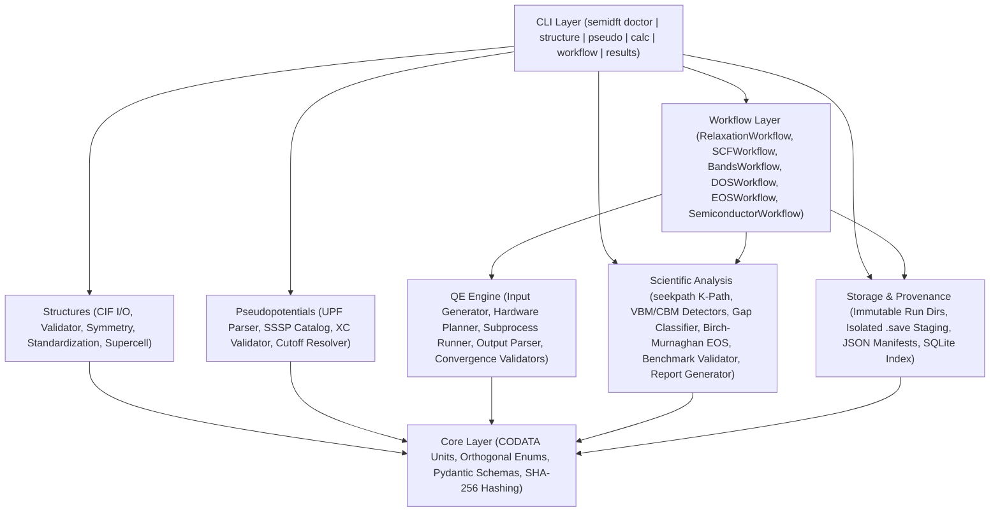

# `semidft` — Semiconductor DFT Workflow & Provenance Toolkit

**`semidft`** is a research-oriented, CLI-first Python toolkit and library for automating semiconductor crystal-structure preparation, **Density Functional Theory (DFT)** calculations with **Quantum ESPRESSO** (`pw.x`, `bands.x`, `dos.x`), numerical convergence verification, electronic-structure & Equation-of-State (EOS) post-processing, and cryptographic computational provenance.

Unlike simple input-conversion scripts, `semidft` enforces **physical and numerical rigor at every stage**: it separates process execution status from scientific convergence validation, converts physical tolerances explicitly at the engine boundary using CODATA 2018/2022 constants, preserves coordinate-frame consistency across `spglib`/`seekpath` standardizations, stages SCF charge densities into isolated downstream workspaces without corrupting shared artifacts, and tracks every calculation in immutable, hash-verified run directories indexed by SQLite.

---

## Key Capabilities

- **Crystallographic Rigor & Provenance (`semidft.structures`):**
  - Imports/exports CIF structures while explicitly rejecting disordered or partially occupied sites (`occupancy < 1.0`), overlapping atoms, or singular lattice matrices.
  - Performs space-group symmetry detection (`spglib`), primitive/conventional standardization, and $N_1 \times N_2 \times N_3$ supercell generation while recording exact $3 \times 3$ transformation matrices (`TransformationStep`) and periodic-translation-invariant SHA-256 hashes (`structure_hash`).
  - Ships with canonical reference structures for diamond `Si` (`Fd-3m`, #227), diamond `Ge` (`Fd-3m`, #227), and zincblende `GaAs` (`F-43m`, #216).

- **Pseudopotential Consistency & SSSP Catalog (`semidft.pseudopotentials`):**
  - Parses UPF v1/v2 `<PP_HEADER>` metadata (element, XC functional, `NC`/`USPP`/`PAW` type, relativistic treatment, $Z_{\mathrm{valence}}$, recommended cutoffs, and SHA-256 checksum).
  - Prevents mixing incompatible exchange-correlation functionals across multi-element compounds and preserves pseudopotential-specific dual ratios ($E_{\mathrm{cut}}^{\rho} / E_{\mathrm{cut}}^{\mathrm{wfc}}$) rather than assuming a fixed $4:1$ ratio.

- **Orthogonal Execution & Scientific Validation States (`SPEC-01`):**
  - Never equates `exit_code == 0` with physical convergence. Every calculation manifest records two independent state machines:
    - **`ExecutionStatus`**: `CREATED` $\rightarrow$ `PREPARED` $\rightarrow$ `RUNNING` $\rightarrow$ `COMPLETED` | `FAILED` | `INTERRUPTED`
    - **`ValidationStatus`**: `NOT_EVALUATED` $\rightarrow$ `CONVERGED` | `UNCONVERGED` | `PARSE_FAILED`
  - Downstream workflows (`SCF`, `Bands`, `DOS`) refuse to proceed unless upstream steps satisfy **both** `ExecutionStatus.COMPLETED` and `ValidationStatus.CONVERGED`.

- **Calculation-Specific Convergence Validators & Two-Stage Protocol (`SPEC-02`):**
  - Dedicated validators for `scf`, `nscf`/`bands` (verifying non-self-consistent k-point eigenvalue evaluation without requiring SCF loop markers), `relax` (electronic + ionic energy `etot_conv_thr` + ionic force `forc_conv_thr`), and `vc-relax` (adding cell hydrostatic pressure `press_conv_thr` and post-processing residual stress tensor tolerance `stress_tolerance_gpa`).
  - Two-stage convergence engine (`semidft.engines.qe.convergence.protocol`):
    - **Stage A:** Sweeps $(E_{\mathrm{cut}}^{\mathrm{wfc}}, E_{\mathrm{cut}}^{\rho})$ pairs on a fixed crystal geometry and k-mesh.
    - **Stage B:** Fixes the converged cutoff pair and sweeps reciprocal-space k-point meshes, selecting the `"lowest_cost_configuration_within_tolerances"` across total energy per atom, maximum atomic force, stress, and Kohn–Sham band gap.

- **Isolated SCF Staging & Safe Scratch Cleanup (`SPEC-03`):**
  - `SCFWorkflow` accepts either a converged relaxed structure (`relax`/`vc-relax`) or a directly validated crystal structure.
  - `stage_scf_reference_data` copies only required reference artifacts (`data-file-schema.xml`, `charge-density.dat`/`charge-density.hdf5`, `paw.txt`, and `.UPF` files) into isolated child `scratch/<prefix>.save/` directories for `Bands` and `DOS`, preventing concurrent post-processing steps from mutating shared SCF directories.
  - `cleanup_temporary_wavefunctions` unlinks only temporary `.wfc*` and `.mix*` files after all dependent downstream calculations have reached `CONVERGED`.

- **Electronic Structure & Birch–Murnaghan EOS Analysis (`SPEC-04`, `SPEC-05`, `SPEC-06`):**
  - Enforces `seekpath` standardized primitive cell coordinate-frame consistency between `CELL_PARAMETERS` and `K_POINTS crystal_b`.
  - Occupation-aware VBM and CBM detectors (`BandEdge`) and modulo-$\mathbb{Z}^3$ reciprocal-lattice equivalence classifier distinguishing **fundamental gap** vs **minimum direct gap**, recording sampling provenance (`high_symmetry_path` vs `uniform_nscf_mesh`) and structured experimental reference metadata (value, temperature, phase, gap definition, uncertainty, and literature DOI).
  - 3rd-order Birch–Murnaghan Equation of State (`EOSWorkflow`, `fit_birch_murnaghan_eos`) fitting $E(V)$ curves across strained volumes to extract equilibrium volume $V_0$, lattice constant $a_0$, isothermal bulk modulus $B_0$ (GPa), and pressure derivative $B_0'$.

---

## System Architecture



### Repository Structure

```text
semiconductor-dft-workflow/
├── AGENTS.md                        # Engineering & scientific-integrity guidelines
├── pixi.toml                        # Pixi environment manifest & task definitions
├── pixi.lock                        # Locked reproducible conda-forge/PyPI environment
├── pyproject.toml                   # Python package metadata, pytest, ruff & mypy config
├── configs/
│   ├── benchmarks/
│   │   └── reference_semiconductors.yaml  # PBE & experimental benchmarks (Si, Ge, GaAs)
│   ├── calculations/                # Default calculation protocol YAML templates
│   ├── materials/                   # Material workflow configs (si.yaml, ge.yaml, gaas.yaml)
│   └── pseudopotentials/
│       └── sssp-pbe.yaml            # SSSP PBE Efficiency v2.0 metadata catalog
├── data/
│   └── structures/                  # Canonical reference CIF files (Si.cif, Ge.cif, GaAs.cif)
├── src/semidft/
│   ├── core/                        # Units, exceptions, models, schemas, hashing, logging
│   ├── structures/                  # Builder, CIF I/O, validator, symmetry, supercell
│   ├── pseudopotentials/            # UPF header parser, catalog, validator, cutoff resolver
│   ├── engines/qe/                  # Executable discovery, hardware planner, runner, parser
│   │   └── convergence/             # Electronic, ionic, cell validators & 2-stage protocol
│   ├── workflows/                   # Relaxation, SCF, Bands, DOS, EOS & Semiconductor workflows
│   ├── analysis/                    # K-path, VBM/CBM, gap classifier, EOS, plots & reports
│   ├── storage/                     # Immutable artifacts, manifests, staging & SQLite index
│   └── cli/                         # Typer CLI application and command groups
└── tests/
    ├── unit/                        # Tier 1 unit tests & Tier 2 Hypothesis invariant tests
    ├── integration/                 # Tier 3 live Quantum ESPRESSO integration tests
    ├── scientific/                  # Tier 4 PBE & experimental semiconductor benchmark tests
    └── regression/                  # Tier 5 versioned QE 7.5 parser & schema snapshots
```

---

## Explicit Unit Conventions (`SPEC-02`)

All internal models use explicit unit suffixes (`_ev`, `_ry`, `_angstrom`, `_gpa`) and convert to/from Quantum ESPRESSO units strictly at the `semidft.engines.qe` boundary using CODATA 2018/2022 constants:

| Physical Quantity | Internal Field & Unit | QE Input / Output Unit | Conversion Constant (`semidft.core.units`) |
|---|---|---|---|
| Length / Lattice | `_angstrom` ($\text{\AA}$) | `angstrom` / `Bohr` | `BOHR_TO_ANGSTROM = 0.529177210903` |
| Energy / Ionic Energy Thr. | `energy_tolerance_ev` ($\mathrm{eV}$) | `etot_conv_thr` ($\mathrm{Ry}$) | `RY_TO_EV = 13.605693122994` |
| Electronic SCF Thr. | `conv_thr_ry` ($\mathrm{Ry}$) | `conv_thr` ($\mathrm{Ry}$) | Native $\mathrm{Ry}$ |
| Plane-Wave Cutoffs | `ecutwfc_ry`, `ecutrho_ry` ($\mathrm{Ry}$) | `ecutwfc`, `ecutrho` ($\mathrm{Ry}$) | Native $\mathrm{Ry}$ |
| Force / Ionic Force Thr. | `force_tolerance_ev_per_angstrom` ($\mathrm{eV/\AA}$) | `forc_conv_thr` ($\mathrm{Ry/Bohr}$) | `RY_PER_BOHR_TO_EV_PER_ANGSTROM ≈ 25.71103374` |
| Hydrostatic Pressure Thr. | `pressure_tolerance_gpa` ($\mathrm{GPa}$) | `press_conv_thr` ($\mathrm{kbar}$) | `GPA_TO_KBAR = 10.0` |
| Stress Tensor Residual | `stress_tolerance_gpa` ($\mathrm{GPa}$) | Stress tensor ($\mathrm{kbar}$) | `KBAR_TO_GPA = 0.1` |

---

## Installation & Setup

### 1. Install the Reproducible Environment with Pixi

Requires [Pixi](https://pixi.sh):

```bash
pixi install
```

### 2. Configure Quantum ESPRESSO (`pw.x`, `bands.x`, `dos.x`)

`semidft` automatically discovers Quantum ESPRESSO binaries in the following order:
1. `SEMIDFT_QE_BIN_DIR` environment variable (if set)
2. `.pixi/envs/default/bin/`
3. Sibling `../qe-7.5-ReleasePack/qe-7.5/bin/` directory
4. System `PATH`

Verify your environment, MPI launcher, and hardware execution profiles:

```bash
pixi run semidft doctor --benchmark
```

### 3. Place Pseudopotential `.UPF` Files Locally

In accordance with `AGENTS.md` §6.2, third-party `.UPF` pseudopotential binaries are **not** redistributed in the public Git repository (they are excluded via `.gitignore`). Place your validated `.UPF` files (`Si.UPF`, `Ge.UPF`, `Ga.UPF`, `As.UPF`) in:

```text
data/pseudopotentials/sssp-pbe-v2/
```

---

## CLI Usage Guide

### 1. Environment & Hardware Diagnostics (`semidft doctor`)

```bash
# Display human-readable environment & hardware table
pixi run semidft doctor

# Compare CPU hybrid (-nk k-point pools) vs ROCm iGPU profiles in JSON
pixi run semidft doctor --benchmark --json
```

### 2. Crystal Structure Operations (`semidft structure`)

```bash
# Inspect built-in reference semiconductor (Si, Ge, GaAs) or a local CIF file
pixi run semidft structure inspect Si --json
pixi run semidft structure inspect data/structures/GaAs.cif

# Validate structure geometry, minimum interatomic distances, and site occupancies
pixi run semidft structure validate data/structures/Si.cif

# Detect space group, Hall symbol, Pearson symbol, and Wyckoff positions
pixi run semidft structure symmetry GaAs --json

# Standardize to primitive or conventional cell and export to CIF
pixi run semidft structure standardize data/structures/Si.cif --cell primitive --out Si_prim.cif

# Build an N1 x N2 x N3 supercell
pixi run semidft structure supercell Si --scaling 2,2,2 --out Si_2x2x2.cif
```

### 3. Pseudopotential Inspection & Validation (`semidft pseudo`)

```bash
# Inspect SSSP PBE v2.0 catalog recommendation for an element
pixi run semidft pseudo inspect Si --json

# Check recommended (ecutwfc_ry, ecutrho_ry) for a multi-element compound
pixi run semidft pseudo check-material Ga,As --json

# Parse and validate local UPF v2 files for XC and relativistic consistency
pixi run semidft pseudo validate data/pseudopotentials/sssp-pbe-v2/Ga.UPF data/pseudopotentials/sssp-pbe-v2/As.UPF
```

### 4. Single Calculation Management (`semidft calc`)

```bash
# Initialize an immutable calculation directory and render pw.in
pixi run semidft calc init --id si-scf-001 --material Si --type scf --out-dir calculations

# Validate rendered input and parameters before execution
pixi run semidft calc validate calculations/si-scf-001

# Execute pw.x and evaluate calculation-specific convergence criteria
pixi run semidft calc run calculations/si-scf-001 --material Si

# Inspect orthogonal ExecutionStatus and ValidationStatus
pixi run semidft calc status calculations/si-scf-001 --json
```

### 5. End-to-End Semiconductor Workflows (`semidft workflow`)

```bash
# Dry-run workflow preparation (renders inputs without invoking pw.x)
pixi run semidft workflow run --config configs/materials/si.yaml --out-dir calculations/si-dryrun --dry-run

# Execute full Relaxation -> SCF -> Bands + DOS workflow
pixi run semidft workflow run --config configs/materials/si.yaml --out-dir calculations/si-full
```

### 6. Results & Scientific Benchmark Reports (`semidft results`)

```bash
# Query total energy, forces, pressure, and convergence status
pixi run semidft results energy calculations/si-scf-001 --json

# Classify fundamental vs minimum direct band gap along seekpath k-path
pixi run semidft results band-gap calculations/si-bands-001 --material Si --json

# Generate band-structure or DOS plots (PNG)
pixi run semidft results bands calculations/si-bands-001 --material Si
pixi run semidft results dos calculations/si-dos-001

# Generate a Markdown + JSON scientific validation report against PBE & 300 K benchmarks
pixi run semidft results report calculations/si-scf-001 --material Si --a0 5.469 --b0 88.6 --gap 0.61 --indirect
```

---

## Testing & Verification (`5-Tier Test Suite`)

Run the full verification pipeline (`ruff`, `mypy --strict`, and `pytest`):

```bash
# Run linting, formatting check, and strict static type checking
pixi run lint
pixi run format-check
pixi run typecheck

# Run fast offline test suites (Tier 1 Unit, Tier 2 Hypothesis Invariants, Tier 4 Scientific, Tier 5 Regression)
pixi run test-fast

# Run Tier 3 live Quantum ESPRESSO integration tests (requires pw.x, bands.x, dos.x, and Si.UPF)
pixi run pytest -m integration -v

# Run all 5 test tiers with coverage report
pixi run test
```

---

## Security & Public Repository Hygiene

To keep this repository clean, reproducible, and safe for public hosting, `.gitignore` enforces strict exclusions across six categories:
1. **Secrets & Credentials:** `.env*`, `*.pem`, `*.key`, `*.p12`, `id_rsa*`, `id_ed25519*`, `*secret*`, `*credentials*`, `*token*`, `.netrc`, `.pypirc`.
2. **Copyrighted Literature & Third-Party Pseudopotentials:** `docs/*.pdf`, `*.pdf`, `*.epub`, and `data/pseudopotentials/**/*.UPF` (only tiny synthetic UPF headers in `tests/fixtures/pseudos/*.UPF` are tracked for offline unit testing).
3. **Internal AI Agent & Local Planning Files:** `.claude/`, `.gemini/`, `.cursor/`, `.agent/`, `.antigravity/`, `docs/Instruction-plan for semidft.md`, and `docs/superpowers/`.
4. **QE Runtime Outputs & Scratch Wavefunctions:** `/calculations/`, `/runs/`, `/scratch/`, `*.wfc*`, `*.mix*`, `*.save/`, `charge-density.*`, `*.sqlite*`.
5. **Local Environments & Caches:** `.pixi/` (while tracking `pixi.toml` and `pixi.lock`), `.hypothesis/`, `.pytest_cache/`, `.mypy_cache/`, `.ruff_cache/`.

---

## License

MIT License.
